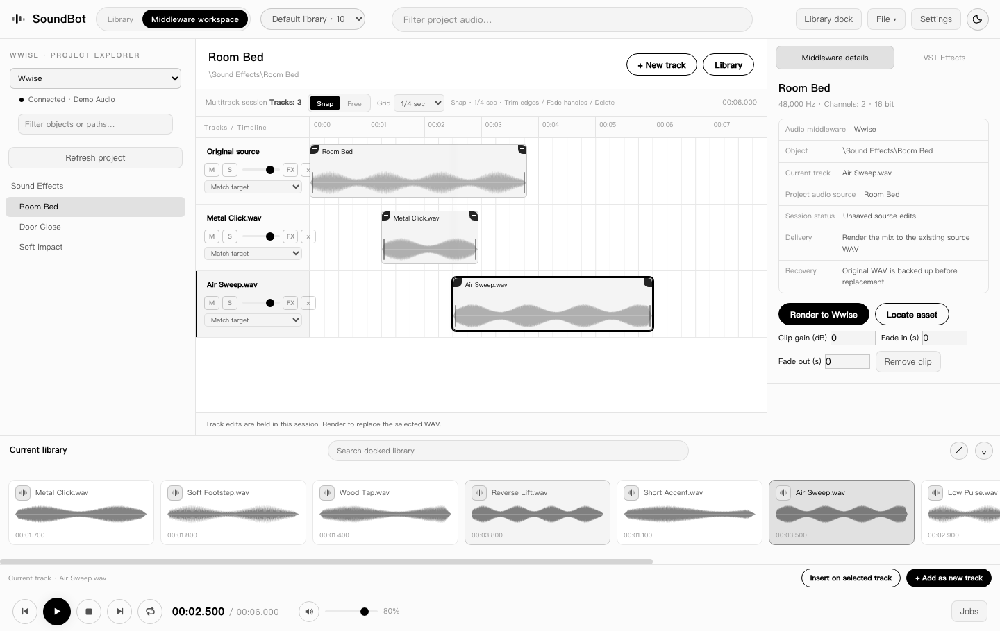

<p align="center"></p>

# SoundBot

**Local sound library, waveform editor, and middleware workspace.** Find and audition sounds, trim them in the waveform editor, and deliver a WAV to a DAW or middleware project.

[中文 / English](README.md) · [Releases](https://github.com/Huckrick/SoundBot/releases) · [Changelog](CHANGELOG.md)



## Download

The current source version is **v1.0.0 (stable)**. Its installers will appear on the [Releases page](https://github.com/Huckrick/SoundBot/releases) once published. The table links to the published **v0.2.1-beta.3**.

| Platform | Published installer |
| --- | --- |
| macOS 14+ on Apple Silicon | [Download DMG](https://github.com/Huckrick/SoundBot/releases/download/v0.2.1-beta.3/SoundBot-0.2.1-beta.3-arm64.dmg) |
| Windows 10/11 x64 | [Download EXE](https://github.com/Huckrick/SoundBot/releases/download/v0.2.1-beta.3/SoundBot-Setup-0.2.1-beta.3.exe) |

[SHA-256 checksums](https://github.com/Huckrick/SoundBot/releases/download/v0.2.1-beta.3/SHA256SUMS.txt) · [All releases](https://github.com/Huckrick/SoundBot/releases)

## Use SoundBot

1. Create or select a library and drag in files or folders. SoundBot indexes the original locations.
2. Search the library and select a sound. The waveform supports audition, a selected range, loop playback, gain, and fades.
3. Set the DAW project media folder, then drag the selection by its upper edge. For multitrack edits and delivery, open the middleware workspace. See the [host workflow guide](docs/middleware.md).

Core editing works offline. The library database, local settings, and backups live in the user's data directory. Set `SOUNDBOT_USER_DATA_DIR` for an isolated test instance.

## Build locally

Use Python 3.12 and Node.js 24 on the target OS and architecture. The build script writes installers to `dist-electron/`.

```bash
python -m pip install --only-binary=av -r backend/requirements.txt -r backend/requirements-build.txt
npm ci
python scripts/build.py --skip-dependency-install
```

See the [build and release guide](docs/build-and-retrieval.md) for build artifacts, checksums, and release review.

Maintained by **Huckrick** under [GPL-3.0-or-later](LICENSE). [Third-party notices](tests/build/licenses/THIRD_PARTY_AUDIO_NOTICES.txt).

Forks are welcome. Huckrick maintains the upstream repository, which does not accept external code or data submissions.
