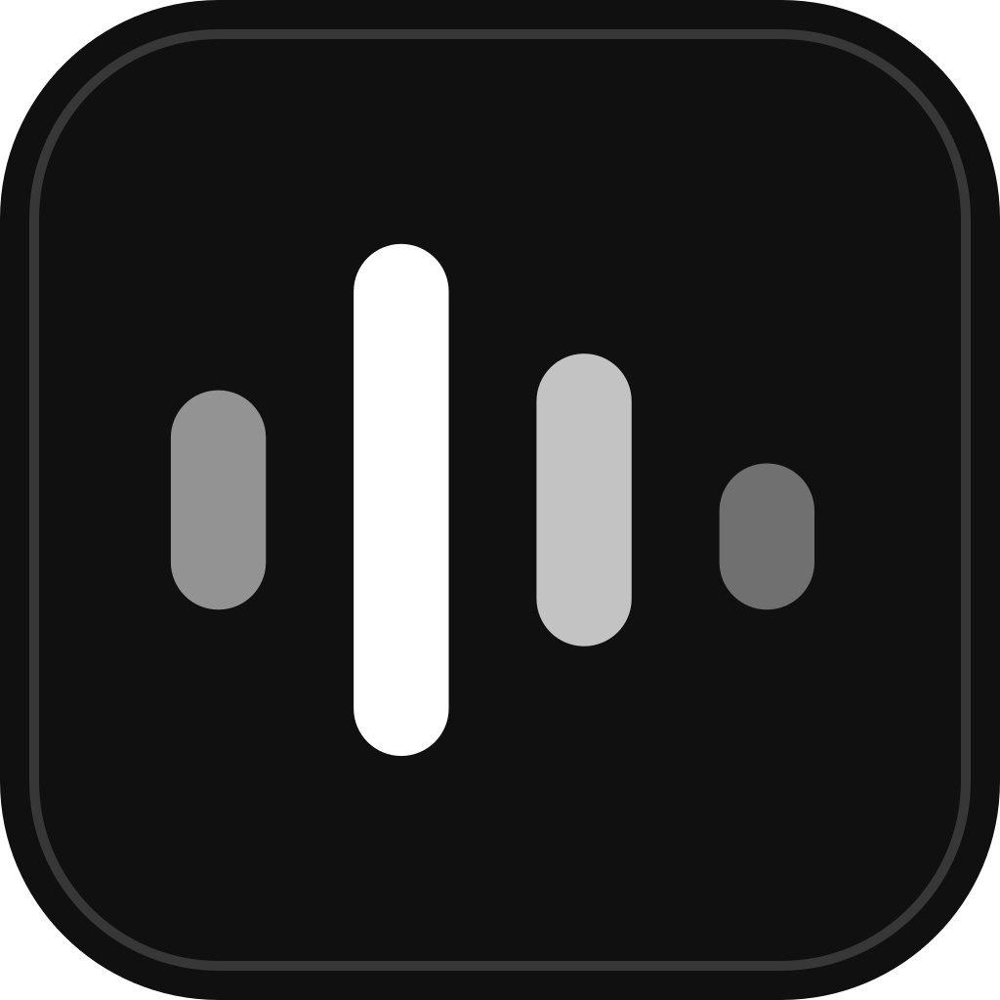
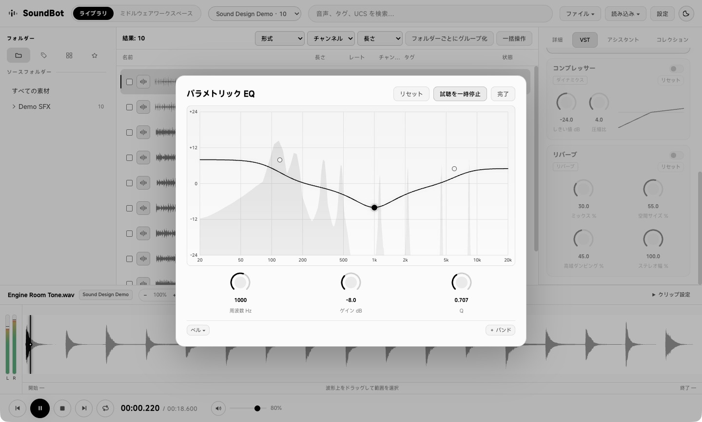

<h1 align="center">SoundBot</h1>

<strong>日本語</strong> · <a href="README.md#简体中文">简体中文</a> · <a href="README.md#english">English</a> · <a href="https://github.com/Huckrick/SoundBot/releases">リリース</a>

SoundBot は、ゲームオーディオ制作向けの無料のオープンソースアプリです。ローカルの効果音を探して試聴し、波形を編集して、DAW やミドルウェアに渡すところまでを一つの画面で進められます。

内蔵 EQ の拡大エディター。試聴しながらスペクトラムを確認し、波形の再生位置と左右のレベルも見られます。

## ダウンロードとインストール

安定版のインストーラーと SHA-256 チェックサムは、GitHub の同じリリースからダウンロードできます。以前のバージョンはリリース一覧から入手できます。 [最新リリース](https://github.com/Huckrick/SoundBot/releases/latest) · [リリース一覧](https://github.com/Huckrick/SoundBot/releases) · [変更履歴](CHANGELOG.md)

| 対応環境 | ダウンロードするファイル | インストール方法 |
| --- | --- | --- |
| macOS 14 以降、Apple Silicon | `SoundBot-<バージョン>-arm64.dmg` | ディスクイメージを開き、SoundBot を書き込み可能なアプリケーションフォルダにドラッグします。 |
| Windows 10/11、x64 | `SoundBot-Setup-<バージョン>.exe` | インストーラーを開き、現在のユーザーが書き込めるフォルダにインストールします。 |

ダウンロードしたファイルの SHA-256 は、macOS では `shasum -a 256 <ファイル>`、Windows の PowerShell では `Get-FileHash -Algorithm SHA256 <ファイル>` で確認できます。同じリリースの `SHA256SUMS.txt` と照合してください。OS によって起動がブロックされた場合は、リリースノートで署名の状況を確認してください。

## 使い方

### 効果音を整理する、探す

ライブラリを作り、ファイルやフォルダをドラッグして追加します。元ファイルはその場所に残り、ファイル名、説明、タグ、UCS 分類からキーワードで検索できます。取り込み中でも検索でき、波形は表示に必要なときに生成されます。詳細欄ではサンプルレートやチャンネル数、ファイル内のタグ、埋め込みアートワークを確認できます。追加済みのフォルダは右クリックで変更を確認でき、素材を移動した場合はライブラリから参照先を更新できます。

### 試聴と波形編集

下部の波形で範囲を選択し、フェードやゲインを調整できます。マウスホイールでポインターを中心に拡大・縮小し、Shift を押しながら回すと横に移動します。スペースキーで再生・一時停止できます。テキスト入力欄では通常どおり空白を入力できます。

選択範囲の上端からドラッグすると DAW に渡せます。素材全体を使う場合は、一覧の波形サムネイルを Alt（Mac では Option）を押しながらドラッグします。初回は DAW プロジェクトのメディアフォルダを指定し、WAV の準備ができたらもう一度ドラッグします。

### ミドルウェアワークスペース

一覧の波形サムネイルをワークスペースやタイムラインにドラッグすると、素材全体を配置できます。ルーラー上で再生位置を移動し、クリップの左右の端の下半分をドラッグしてトリミングできます。複数トラックで素材を重ね、フェードハンドルをドラッグして長さを調整し、右クリックでカーブを選べます。同じトラックで隣り合うクリップが一部重なるとクロスフェードがかかり、重なった箇所ごとにカーブを変更できます。出力先がステレオの場合は、波形上でパンの制御点を追加、移動、削除できます。

| ミドルウェア | SoundBot からの反映方法 |
| --- | --- |
| Wwise | ローカルの WAAPI で接続し、読み込んだプロジェクトツリー全体を閲覧・検索できます。対応するモノラルまたはステレオの 16/24 ビット PCM WAV は、元ファイルをバックアップしてから同じパスに書き戻せます。 |
| FMOD Studio、CRI Atom Craft | プロジェクトの素材フォルダに新しい WAV を書き出し、各ツールでインポートまたは登録します。 |

[ミドルウェア別の手順と対応範囲](docs/middleware.md)

### 内蔵エフェクトと VST3

パラメトリック EQ、コンプレッサー、リバーブ、ラウドネス正規化、リアルタイムのラウドネスメーターを内蔵しています。EQ の **展開** を押すと、試聴しながら大きなグラフでスペクトラムと周波数特性を確認できます。グラフをダブルクリックしてバンドを追加し、ポイントをドラッグして周波数とゲインを調整します。右クリックでフィルターの種類を変更でき、周波数、ゲイン、Q は対応するノブや数値欄でも調整できます。

VST パネルを開くと、標準のインストール先から VST3 が検出されます。追加したプラグインの名前をクリックすると、プラグイン固有のエディターを開けます。Windows では SoundBot の小ウィンドウとして表示され、サイズ変更やズームの可否はプラグイン側の対応に依存します。エフェクトチェーン内での並べ替え、バイパス、削除もできます。新しいプラグインをインストールしたら **設定 → VST3** から再スキャンできます。

ライブラリの試聴には共通のマスターエフェクトを使います。素材を切り替えても設定は維持され、選択範囲を DAW に渡すときはその効果を WAV に反映します。ワークスペースではトラックごとにエフェクトと設定を保持し、書き出しや書き戻しが成功するとリセットします。プラグインの処理に失敗した場合、試聴では警告を表示してそのプラグインをバイパスし、書き出しでは処理を中断して編集内容を保持します。

## 表示言語

**設定 → 一般 → 言語** で日本語、簡体字中国語、繁体字中国語、英語、ブラジルポルトガル語、スペイン語を選べます。選んだ言語は次回の起動時にも使われます。素材名、ファイルに含まれるタグ、外部ツールやプラグインの画面は元の言語で表示されます。

## ファイルへのアクセスとプライバシー

| 操作 | アクセスするファイルやデータ |
| --- | --- |
| 取り込みと試聴 | 選択したファイルとフォルダを読み取り、検索インデックスとキャッシュをローカルのアプリデータフォルダに保存します。キーワード検索、試聴、波形編集はオフラインで使えます。 |
| 音声の書き出し | 選択した DAW またはミドルウェアの素材フォルダに書き込みます。Wwise への書き戻しでは対象を確認し、元ファイルをバックアップします。 |
| VST3 の検出と読み込み | 標準のインストール先と登録済みの場所を検索します。確認後にプラグインのコードが現在のユーザー権限で動作します。 |
| 任意のアシスタント機能 | サービスの API キーを保存・使用するときに、OS の資格情報ストアへのアクセスを求められることがあります。外部サービスを利用すると、メッセージと会話の文脈が設定したサービスへ送られます。 |

macOS では、保護されたフォルダを選ぶとアクセス許可を求められることがあります。読み取れない場合は、アクセスできるフォルダを選択してください。通常の利用にはフルディスクアクセスや管理者パスワードは不要です。更新前にアプリデータフォルダをバックアップできます。 [データの保存場所と権限](docs/release-review.md)

## サポートとフィードバック

起動や取り込みに問題がある場合は、対応 OS とアーキテクチャ、素材フォルダへのアクセスを確認してください。ログは **設定 → 診断とバージョン情報 → ログを開く** から確認できます。ログを共有する際は、個人情報やファイルパスを取り除いてください。動作確認の結果や既知の制約は各リリースノートに記載しています。 [リリース一覧](https://github.com/Huckrick/SoundBot/releases)

不具合や要望は Issues や Discussions にお寄せください。対応は随時行います。リリースの安全性を保つため、プルリクエストやコードの投稿は受け付けていません。公開の投稿には API キー、音源、データベース、ログの原文、個人のファイルパスを添付しないでください。 [Issue を作成](https://github.com/Huckrick/SoundBot/issues/new/choose) · [Discussions](https://github.com/Huckrick/SoundBot/discussions) · [リポジトリの方針](.github/CONTRIBUTING.md) · [セキュリティポリシー](.github/SECURITY.md)

## 開発者と謝辞

SoundBot は **Huckrick** が開発・メンテナンスしており、ソースコードは GPL-3.0-or-later で公開しています。**設定 → 診断とバージョン情報** では、開発者、同梱フォント MiSans の利用条件、各コンポーネントの出典、コミュニティへの謝辞を確認できます。 [クレジットと出典](docs/credits.md) · [ライセンス](LICENSE) · [サードパーティーのライセンス表示](tests/build/licenses/THIRD_PARTY_AUDIO_NOTICES.txt)

## ビルドとリリース

ビルドには Python 3.12 と Node.js 24 を使用します。GitHub Actions は各 OS の環境でインストーラーをビルド・検証し、チェックサムとビルドの来歴情報を添えたリリースの下書きを用意します。 [ビルドとリリースの手順](docs/build-and-retrieval.md) · [配布時の確認項目](docs/release-review.md)
