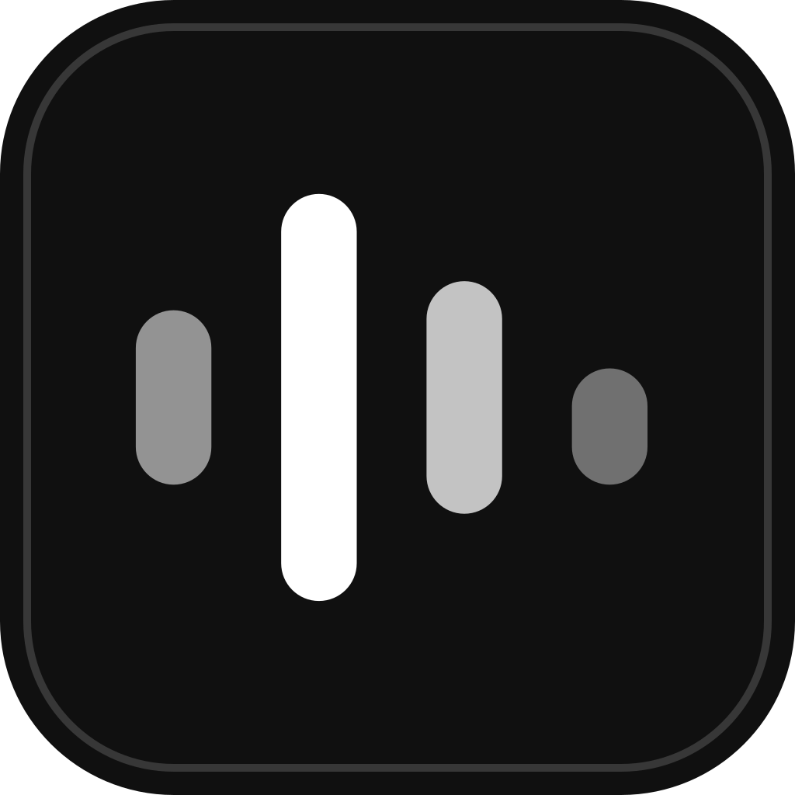
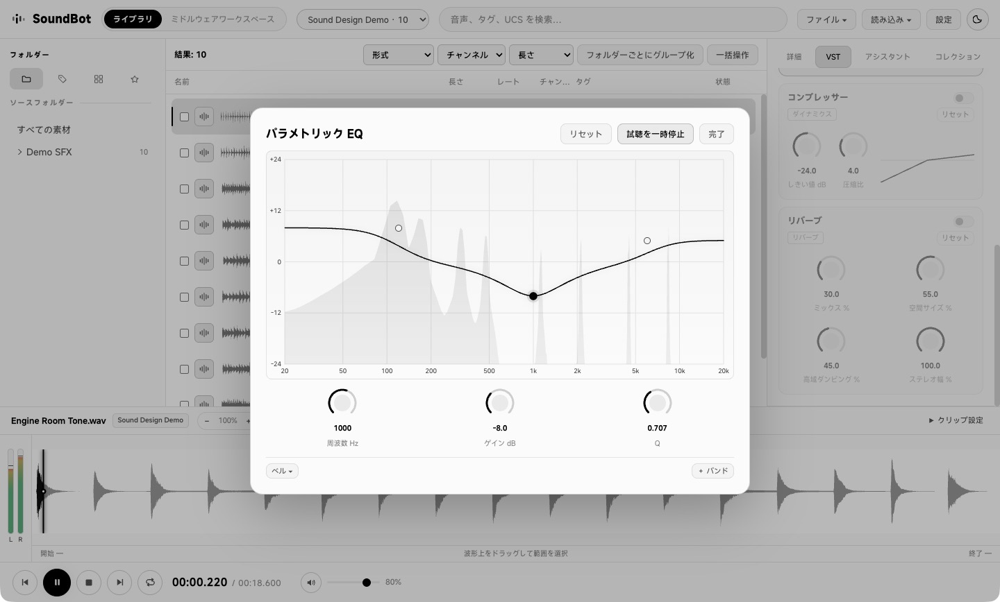
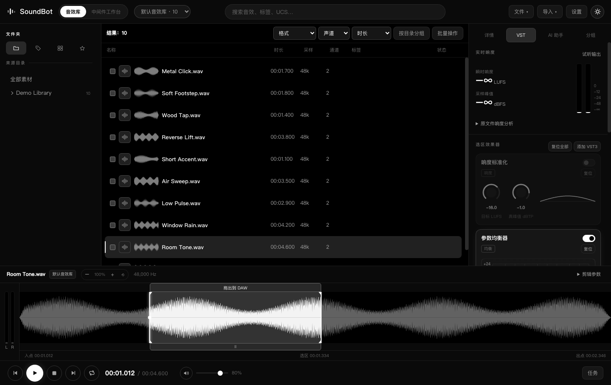
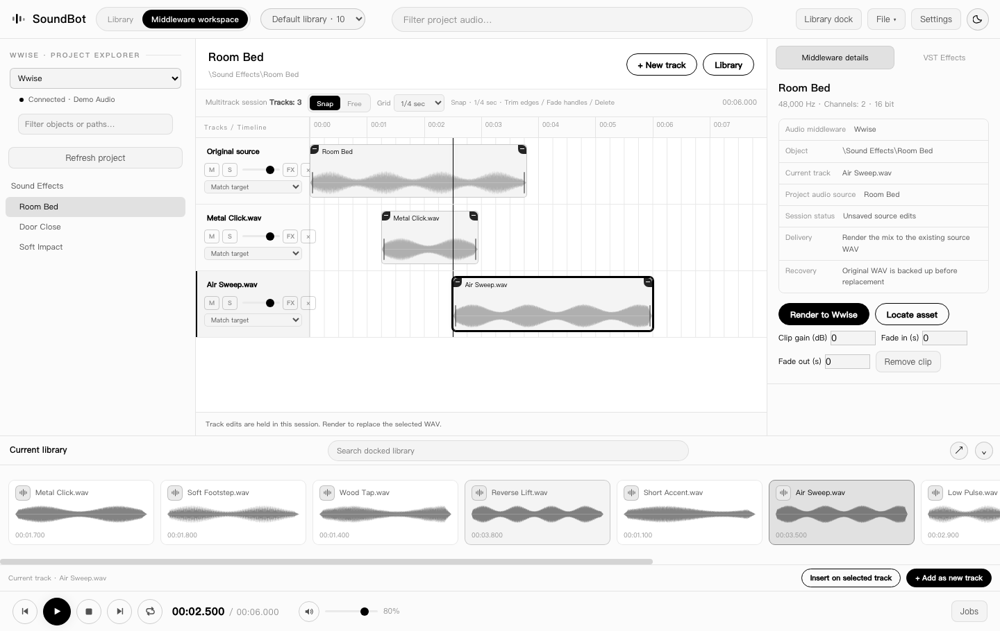

<h1 align="center">SoundBot</h1>

<a href="#日本語">日本語</a> · <a href="#简体中文">简体中文</a> · <a href="#english">English</a>

Huckrick が開発するゲームオーディオ向けの無料・オープンソース効果音ライブラリ。オフラインのキーワード検索、波形編集、Wwise への書き戻し、WAV 書き出しに対応。 由 Huckrick 开发的免费开源游戏音效库，支持离线关键词检索、波形编辑、Wwise 写回和 WAV 导出。 Huckrick’s free, open-source sound library manager for game audio, with offline keyword search, waveform editing, Wwise writeback, and WAV export.

<strong><a href="https://github.com/Huckrick/SoundBot/releases/latest">最新版をダウンロード · 下载最新稳定版 · Download the latest stable release</a></strong>

<a href="docs/release-history.md">過去のリリース · 历史发行档案 · Historical releases</a>

## 日本語

SoundBot は、ゲームオーディオ制作向けの無料のオープンソースアプリです。ローカルの効果音を探して試聴し、波形を編集して、DAW やミドルウェアに渡すところまでを一つの画面で進められます。

内蔵 EQ の拡大エディター。試聴しながらスペクトラムを確認し、波形の再生位置と左右のレベルも見られます。

### ダウンロードとインストール

最新安定版のページに、Windows と macOS のインストーラーおよび SHA-256 チェックサムが揃っています。旧版の情報は変更履歴にあります。 [最新安定版](https://github.com/Huckrick/SoundBot/releases/latest) · [変更履歴](CHANGELOG.md)

| 対応環境 | ダウンロードするファイル | インストール方法 |
| --- | --- | --- |
| macOS 14 以降、Apple Silicon | `SoundBot-<バージョン>-arm64.dmg` | ディスクイメージを開き、SoundBot を書き込み可能なアプリケーションフォルダにドラッグします。 |
| Windows 10/11、x64 | `SoundBot-Setup-<バージョン>.exe` | インストーラーを開き、現在のユーザーが書き込めるフォルダにインストールします。 |

ダウンロードしたファイルの SHA-256 は、macOS では `shasum -a 256 <ファイル>`、Windows の PowerShell では `Get-FileHash -Algorithm SHA256 <ファイル>` で確認できます。同じリリースの `SHA256SUMS.txt` と照合してください。OS によって起動がブロックされた場合は、リリースノートで署名の状況を確認してください。

### 使い方

#### 効果音を整理する、探す

ライブラリを作り、ファイルやフォルダを追加します。ライブラリが空のときは、取り込み時に新しいライブラリに名前を付けられます。元ファイルはその場所に残り、ファイル名、説明、タグ、UCS 分類からキーワードで検索できます。取り込み中でも検索でき、波形は表示に必要なときに生成されます。詳細欄ではサンプルレートやチャンネル数、ファイル内のタグ、埋め込みアートワークを確認できます。ソースフォルダーを右クリックすると、変更の確認、参照先の更新、ライブラリからの削除ができます。フォルダーをライブラリから削除しても、ディスク上の元ファイルは保持されます。

**タグ → ファイル名による分類** では、足音、ドア、天候などを元のファイル名から自動で分類します。曖昧な名前は未分類のままです。手動で付けたタグと UCS 分類はそのまま使えます。

タグ画面では、見出しをクリックして各分類を折りたたみ、右側の矢印メニューで分類の順番や項目の並べ方を変更できます。**タグフォルダー** の **＋** でフォルダーを作り、タグの右クリックメニューから移動できます。フォルダーを削除すると、タグはカスタムタグに戻ります。

#### 試聴と波形編集

下部の波形で範囲を選択し、フェードやゲインを調整できます。マウスホイールでポインターを中心に拡大・縮小し、Shift を押しながら回すと横に移動します。スペースキーで再生・一時停止できます。テキスト入力欄では通常どおり空白を入力できます。

初回は DAW プロジェクトのメディアフォルダーを選択します。次回の起動時には前回の保存先が表示され、そのまま使うか変更するかを選べます。波形サムネイルからは素材全体を、波形エディターでは選択範囲の上端から選択部分をドラッグできます。WAV の準備中はマウスボタンを押したまま待つと、そのまま DAW にドロップできます。ミドルウェアのタイムラインに直接ドロップすると、編集可能なクリップを追加できます。ライブラリと下部パネルには同じフォルダー、カテゴリ、検索条件が反映されます。

#### ミドルウェアワークスペース

一覧の波形サムネイルをワークスペースやタイムラインにドラッグすると、素材全体を配置できます。ルーラー上で再生位置を移動し、クリップの左右の端の下半分をドラッグしてトリミングできます。複数トラックで素材を重ね、フェードハンドルをドラッグして長さを調整し、右クリックでカーブを選べます。同じトラックで隣り合うクリップが一部重なるとクロスフェードがかかり、重なった箇所ごとにカーブを変更できます。出力先がステレオの場合は、波形上でパンの制御点を追加、移動、削除できます。

| ミドルウェア | SoundBot からの反映方法 |
| --- | --- |
| Wwise | ローカルの WAAPI で接続し、読み込んだプロジェクトツリー全体を閲覧・検索できます。対応するモノラルまたはステレオの 16/24 ビット PCM WAV は、元ファイルをバックアップしてから同じパスに書き戻せます。 |
| FMOD Studio、CRI Atom Craft | **実験的・実機未検証。** 素材フォルダーに新しい WAV を書き出す想定です。各ホストでのインポート・登録についてフィードバックをお待ちしています。 |

Wwise で対象プロジェクトを開いてローカル WAAPI を有効にし、SoundBot から接続します。既定の接続先は `ws://127.0.0.1:8080/waapi` です。プロジェクトツリーで Sound SFX の音源を選び、別トラックにライブラリ素材を重ねます。書き戻し先は `Originals` 内の書き込み可能なモノラルまたはステレオの 16/24-bit PCM WAV です。共有された音源やループ・キューマーカーのあるファイルは保護されます。書き戻し後は Wwise で試聴し、必要に応じて変換や SoundBank の再生成を行います。元の WAV はクリーンアップ画面のバックアップから復元できます。

[ミドルウェア別の手順と対応範囲](docs/middleware.md)

#### 内蔵エフェクトと VST3

パラメトリック EQ、コンプレッサー、リバーブ、ラウドネス正規化、リアルタイムのラウドネスメーターを内蔵しています。EQ の **展開** を押すと、試聴しながら大きなグラフでスペクトラムと周波数特性を確認できます。グラフをダブルクリックしてバンドを追加し、ポイントをドラッグして周波数とゲインを調整します。右クリックでフィルターの種類を変更でき、周波数、ゲイン、Q は対応するノブや数値欄でも調整できます。

VST パネルを開くと、標準のインストール先から VST3 が検出されます。追加したプラグインの名前をクリックすると、プラグイン固有のエディターを開けます。エディターの準備ができるまで読み込み状況を表示します。Windows ではメインウィンドウの近くに子ウィンドウを開き、移動・最小化・閉じる操作ができます。プラグインが対応している場合は、ウィンドウの端をドラッグしてサイズを調整できます。エフェクトチェーン内での並べ替え、バイパス、削除もできます。新しいプラグインをインストールしたら **設定 → VST3** から再スキャンできます。

ライブラリの試聴には共通のマスターエフェクトを使います。素材を切り替えても設定は維持され、選択範囲を DAW に渡すときはその効果を WAV に反映します。ワークスペースではトラックごとにエフェクトと設定を保持し、書き出しや書き戻しが成功するとリセットします。試聴と WAV の書き出しでは、聞こえるエフェクトの余韻をミックスあたり最大 30 秒保持します。波形には処理済みの音声が順に表示され、選択範囲は元の素材を基準とします。プラグインの処理に失敗した場合、試聴では警告を表示してそのプラグインをバイパスし、書き出しでは処理を中断して編集内容を保持します。

### 表示言語

**設定 → 一般 → 言語** で日本語、簡体字中国語、繁体字中国語、英語、ブラジルポルトガル語、スペイン語を選べます。選んだ言語は次回の起動時にも使われます。素材名、ファイルに含まれるタグ、外部ツールやプラグインの画面は元の言語で表示されます。

### ファイルへのアクセスとプライバシー

| 操作 | アクセスするファイルやデータ |
| --- | --- |
| 取り込みと試聴 | 選択したファイルとフォルダを読み取り、検索インデックスとキャッシュをローカルのアプリデータフォルダに保存します。キーワード検索、試聴、波形編集はオフラインで使えます。 |
| 音声の書き出し | 選択した DAW またはミドルウェアの素材フォルダに書き込みます。Wwise への書き戻しでは対象を確認し、元ファイルをバックアップします。 |
| VST3 の検出と読み込み | 標準のインストール先と登録済みの場所を検索します。確認後にプラグインのコードが現在のユーザー権限で動作します。 |
| 任意のアシスタント機能 | サービスの API キーを保存・使用するときに、OS の資格情報ストアへのアクセスを求められることがあります。外部サービスを利用すると、メッセージと会話の文脈が設定したサービスへ送られます。 |

macOS では、保護されたフォルダを選ぶとアクセス許可を求められることがあります。読み取れない場合は、アクセスできるフォルダを選択してください。通常の利用にはフルディスクアクセスや管理者パスワードは不要です。更新前にアプリデータフォルダをバックアップできます。 [データの保存場所と権限](docs/release-review.md)

### サポートとフィードバック

起動や取り込みに問題がある場合は、対応 OS とアーキテクチャ、素材フォルダへのアクセスを確認してください。ログは **設定 → 診断とバージョン情報 → ログを開く** から確認できます。ログを共有する際は、個人情報やファイルパスを取り除いてください。動作確認の結果や既知の制約は各リリースノートに記載しています。 [リリース一覧](https://github.com/Huckrick/SoundBot/releases)

不具合や要望は Issues や Discussions にお寄せください。対応は随時行います。リリースの安全性を保つため、プルリクエストやコードの投稿は受け付けていません。公開の投稿には API キー、音源、データベース、ログの原文、個人のファイルパスを添付しないでください。 [Issue を作成](https://github.com/Huckrick/SoundBot/issues/new/choose) · [Discussions](https://github.com/Huckrick/SoundBot/discussions) · [リポジトリの方針](.github/CONTRIBUTING.md) · [セキュリティポリシー](.github/SECURITY.md)

### 開発者と謝辞

SoundBot は **Huckrick** が開発・メンテナンスしており、ソースコードは GPL-3.0-or-later で公開しています。**設定 → 診断とバージョン情報** では、開発者、同梱フォント MiSans の利用条件、各コンポーネントの出典、コミュニティへの謝辞を確認できます。 [クレジットと出典](docs/credits.md) · [ライセンス](LICENSE) · [サードパーティーのライセンス表示](tests/build/licenses/THIRD_PARTY_AUDIO_NOTICES.txt)

### ビルドとリリース

ビルドには Python 3.12 と Node.js 24 を使用します。GitHub Actions は各 OS の環境でインストーラーをビルド・検証し、チェックサムとビルドの来歴情報を添えたリリースの下書きを用意します。 [ビルドとリリースの手順](docs/build-and-retrieval.md) · [配布時の確認項目](docs/release-review.md)

[日本語の README を開く](README.ja.md)

## 简体中文

SoundBot 把音效查找、剪辑和交付放在同一个桌面应用里。素材库引用磁盘上的原始文件，按文件名、描述、标签和 UCS 分类做本地关键词检索。素材可边导入边检索，缩略波形按需生成。素材详情展示音频规格、原文件标签和嵌入封面。试听和剪辑支持选区、淡变、增益、参数均衡、混响及响度表。

[查看内置参数均衡器、实时频谱与播放波形](docs/images/library-ja-eq.jpg)

### 界面语言

支持 **简体中文、繁體中文、日本語、English、Português (Brasil)、Español** 共六种语言。在 **设置 → 常规 → 语言** 切换，选择会在下次启动时保留。语言设置适用于 SoundBot 的音效库、波形编辑器、中间件工作台、菜单和设置。素材文件名、源标签及第三方宿主或插件自带的文字保留原文。

### 下载和安装

当前源码版本为 **v1.0.12（稳定版）**。Windows 和 macOS 安装包及 SHA-256 校验清单以最新稳定版发行页为准。 [下载最新稳定版](https://github.com/Huckrick/SoundBot/releases/latest) · [更新日志](CHANGELOG.md)

| 平台 | 发行文件 | 安装方式 |
| --- | --- | --- |
| macOS 14 或更新版，Apple Silicon | `SoundBot-<版本>-arm64.dmg` | 打开镜像，将 SoundBot 拖到有写入权限的应用目录。 |
| Windows 10/11，x64 | `SoundBot-Setup-<版本>.exe` | 运行安装器并选择当前用户可写的安装目录。v1.0.1 起安装器配置为当前用户安装。 |

从同一发行条目下载安装包和 `SHA256SUMS.txt`。在 macOS 使用 `shasum -a 256 <文件>`，在 PowerShell 使用 `Get-FileHash -Algorithm SHA256 <文件>`，将输出与该文件的记录比对。如果系统阻止打开，先查看该发行条目的签名状态。

### 音效库管理

在工作区按空格播放或暂停。文本输入区中的空格照常输入。

1. **建立音效库。** 从「导入」选择文件或文件夹，也可直接拖入。文件留在磁盘原位置，库内保存路径和检索数据。同一库按路径合并重复素材，读到的记录会随着后台导入逐步出现在检索结果里。可从任务面板查看进度、暂停和重试失败项。
2. **维护来源目录。** 在左栏右键来源，选择「检查变更」重扫，移动过素材时可用「重定位」更新引用。重复登记了总目录中的小目录时，右键单独出现的条目，选「撤销此来源目录的导入」，素材仍由总目录收录。想把子目录内容从当前库中移除时，展开总目录后右键该子目录，选「从音效库移除文件夹」。两个入口都保留磁盘原件。
3. **找素材。** 离线关键词检索覆盖文件名、描述、标签和 UCS，可结合目录、格式、时长和声道筛选。使用分组把不同路径的音效归到同一个项目集合，也可收藏常用素材。详情面板显示格式、时长、声道、采样率、源标签和嵌入封面。
4. **试听和交付。** 选中音效后在波形上框选，调整淡入、淡出和增益。先选择 DAW 工程媒体目录，重启时可继续用上次的路径或更改目录。从「拖出到 DAW」、缩略波形或选区上沿拖动，渲染时继续按住，看到系统拖拽图标后松手。SoundBot 将成品写入选定目录，便于 DAW 保持工程媒体引用。

「标签 → 文件名分类」会根据素材原文件名识别脚步、门、天气等常见类别。名称含糊时保持未分类。手动标签和 UCS 分类继续保留。

点击分类标题可收起或展开，右侧「↕」可调整分类顺序，或在分类内按名称和数量排序。在「标签夹」右侧点击「＋」新建，再右键标签选择要移入的标签夹。删除标签夹后，里面的标签会回到「自定义标签」。

在底部波形上滚动鼠标滚轮，以光标位置为中心缩放。按住 Shift 滚动可横移。直接拖动主库或工作台底部的缩略波形，将整条素材交付为 WAV。直接拖到「中间件工作台」或时间线，可继续编辑。已经拖出窗口的音频送回 SoundBot 时会取消交付。主库和底部音效库共享文件夹、分类和搜索条件。

### Wwise 中间件工作台

在 Wwise Authoring 打开项目并启用本机 WAAPI，再在 SoundBot 的 **中间件工作台 → Wwise** 点击连接。默认地址是 `ws://127.0.0.1:8080/waapi`。左侧工程树展示读到的工作单元、文件夹、容器及 Sound SFX 源，并显示可取得的 Wwise 颜色。搜索音效后选择具体源，在右侧详情核对路径与规格。

例如给冲击声补一点低频，可以把待修改的源放在基轨，然后从底部音效库拖一条合适的低频素材到另一轨。缩放时间线对齐起音，用剪辑增益、淡化曲线、交叉淡化和立体声声像微调。静音或独奏对比叠加前后。每轨可独立使用内置效果或第三方 VST3，试听和写回使用同一套混音参数。

点「写回」前核对目标和输出规格。支持工程 `Originals` 中可写的单声道或立体声 16/24-bit PCM WAV，保留原采样率、声道和位深。SoundBot 会检查目标是否被多个源共享、是否已被外部修改、是否含循环或定位标记。通过后备份原件，替换原路径并核对 Wwise 对象绑定。可从清理中心的 Wwise 恢复备份撤回。回到 Wwise 确认实际试听，并按工程需要重新转换或生成 SoundBank。 [完整连接、编辑与故障排查步骤](docs/middleware.md#简体中文)

**FMOD Studio 和 CRI Atom Craft 属于实验性集成，尚未在实际宿主里测试。** 当前实现按选定的素材目录浏览和导出 WAV，宿主里的导入或登记步骤是预期工作流。欢迎反馈操作系统、宿主版本和卡住的步骤。 [实验路径](docs/middleware.md#简体中文) · [讨论区](https://github.com/Huckrick/SoundBot/discussions)

### 内置效果与 VST3

内置参数均衡器、压缩器、混响、响度归一化和实时响度表。EQ 可展开频谱图，双击添加频段，拖点调节频率和增益，右键切换滤波器类型。用数值或旋钮细调频率、增益和 Q，需要时可复位至默认参数。

打开 VST 面板时，SoundBot 自动查找标准安装目录中的 VST3。添加插件后会打开原生编辑窗口，点击插件名可再次打开。加载时显示进度提示。Windows 的插件编辑器在 SoundBot 主窗口附近打开，支持移动、最小化和关闭。原生编辑器支持时可拖动边缘调整尺寸。可在右侧效果链拖动排序、旁通或移除插件。安装新插件后，可在 **设置 → VST3** 重新扫描。

音效库的试听共用一条主输出效果链，切换素材时保留当前设置。准备选区拖出时，SoundBot 将这条效果链渲染到 DAW 媒体目录中的 WAV。中间件工作台为每条轨道保留独立的效果和设置，交付成功后复位。试听、波形预览和 WAV 交付会保留可听的效果尾音，单次混音最多延长 30 秒。选区仍对应原音频，波形在试听时逐段显示渲染结果。插件处理失败时，试听会提示并继续播放旁通信号，交付会停止并保留编辑。

### 文件权限和隐私

| 操作 | 权限或数据 |
| --- | --- |
| 导入或试听 | 读取你选的文件及目录，索引和缓存放在本机应用数据目录。关键词检索、试听和剪辑可离线使用。 |
| 交付音频 | 写入选定的 DAW 媒体目录或中间件素材目录。Wwise 写回前会核对目标源文件并备份。 |
| 扫描和加载 VST3 | 扫描只读取标准安装目录和已登记的插件位置。选定插件并确认加载后，插件以当前用户身份运行本机代码。请选择可信来源。 |
| 使用可选助手 | 保存或使用服务 API 密钥时，系统可能要求访问钥匙串或凭据存储。SoundBot 的输入框只接收服务 API 密钥。调用远端服务时，助手将你的消息和对话上下文发往所配置的服务。 |

在 macOS 访问受保护的文件夹时，系统可能按目录弹出授权提示。若不能读取素材，可以在文件选择器改选可访问的目录。SoundBot 的日常使用无需全磁盘访问或管理员密码。升级前可备份应用数据目录。 [数据位置与验收说明](docs/release-review.md)

### 支持和反馈

- **无法启动或导入**：核对系统和架构，确认来源目录仍可访问。打开 **设置 → 关于 → 打开日志** 查看错误。本机日志可能含文件路径，分享前先脱敏。
- **版本和兼容性**：发行说明记录已通过的验证，包含已知限制。源码维护范围和漏洞处理方式见安全政策。 [发行页](https://github.com/Huckrick/SoundBot/releases) · [安全政策](.github/SECURITY.md)
- 欢迎 Issue 和讨论区交流，不定时处理。出于发布安全考虑，本仓库不接收 Pull Request 与代码提交。请勿在公开区附密钥、素材、数据库、日志原文或私人路径。 [新建 Issue](https://github.com/Huckrick/SoundBot/issues/new/choose) · [讨论区](https://github.com/Huckrick/SoundBot/discussions) · [仓库政策](.github/CONTRIBUTING.md)

### 作者与致谢

SoundBot 由 **Huckrick** 发起、开发和维护，源码采用 GPL-3.0-or-later 许可。在 **设置 → 关于** 可查看作者、MiSans 使用与许可、组件来源和社区致谢。 [完整致谢与来源](docs/credits.md) · [许可证](LICENSE)

## English

SoundBot brings sound library search, waveform editing, and delivery into one desktop app. Libraries reference the original files and index names, descriptions, tags, and UCS categories. Search works during imports, and waveforms are generated on demand. Details show audio properties, source tags, and embedded artwork. The editor includes range selection, fades, gain, parametric EQ, reverb, and live loudness metering.

[See the built-in parametric EQ, live spectrum, and playback waveform](docs/images/library-ja-eq.jpg)

### Interface languages

SoundBot supports **Simplified Chinese, Traditional Chinese, Japanese, English, Brazilian Portuguese, and Spanish**. Choose a language in **Settings → General → Language**. SoundBot remembers the choice and applies it to the library, waveform editor, middleware workspace, menus, and settings. File names, source tags, and labels supplied by external hosts or plug-ins stay in their original language.

### Download and install

The current source version is **v1.0.12 (stable)**. The latest stable release lists the published Windows and macOS installers and their SHA-256 checksums. [Download the latest stable release](https://github.com/Huckrick/SoundBot/releases/latest) · [Changelog](CHANGELOG.md)

| Platform | Release file | Installation |
| --- | --- | --- |
| macOS 14 or later, Apple Silicon | `SoundBot-<version>-arm64.dmg` | Open the disk image and drag SoundBot to an applications folder you can write to. |
| Windows 10/11, x64 | `SoundBot-Setup-<version>.exe` | Run the installer and choose a folder you can write to. From v1.0.1 the installer is configured for the current user. |

Download the installer and `SHA256SUMS.txt` from the same release. Run `shasum -a 256 <file>` on macOS or `Get-FileHash -Algorithm SHA256 <file>` in PowerShell and compare the result with the entry for that file. If your OS blocks the app, check the signing status in the release notes first.

### Manage a sound library

Press Space to play or pause in the workspace. In text fields, Space types a space.

1. **Import.** Add files or folders from the Import menu or drag them into the library. SoundBot indexes the original paths and shows results as batches finish. Open the import activity to check progress, pause, or retry failures.
2. **Maintain sources.** Right-click a registered source to check for changes or relocate it after moving media. With overlapping source folders, removing the separately registered source leaves sounds indexed by the parent in the library. Removing the nested folder from the parent tree also removes its catalog entries and registrations. Original files stay on disk.
3. **Find and organize.** Search filenames, descriptions, tags, and UCS categories offline. Narrow the results by folder, format, duration, or channels, and collect sounds with favorites and groups. The inspector shows audio properties, embedded metadata, and cover art when the file supplies it.
4. **Audition and deliver.** Mark a range and adjust fades or gain. Choose the DAW project's media folder on first use. At startup, you can keep or change the saved folder. Drag the **Drag to DAW** control, the top of a selection, or a thumbnail waveform. While the WAV renders, keep holding the mouse button and drop when the system drag icon appears. The rendered file is delivered to the chosen media directory.

Open **Tags → Filename categories** to browse common groups such as footsteps, doors, and weather. SoundBot uses the original filename and leaves ambiguous names uncategorized. Manual tags and UCS categories are preserved.

Click a tag section heading to collapse or expand it. Use its arrow menu to move the section or sort its entries by name or count. Create a tag folder with **＋**, then right-click a tag to move it. Deleting the folder returns its tags to **Custom tags**.

Scroll over the waveform editor to zoom around the pointer. Hold Shift while scrolling to pan. Drag a thumbnail waveform from either library view to deliver the entire sound as a WAV. Drop directly on the middleware tab or timeline to keep editing the source as a clip. Returning an external drag to SoundBot cancels the handoff. The main library and the dock share folders, categories, and search filters.

### Wwise middleware workspace

Open your project in Wwise Authoring and enable local WAAPI. In SoundBot, select **Middleware Workspace → Wwise → Connect**. The default address is `ws://127.0.0.1:8080/waapi`. Browse or search the loaded work units, folders, containers, and Sound SFX sources. Select a source and verify its path and audio format in the inspector.

For example, to give an impact more low end, drag a low-frequency layer from the dock onto a second track, zoom in to align the attacks, and compare using mute and solo. Trim with a clip's lower edges, adjust gain and fade curves on the clip, and set a crossfade for each overlap when automatic crossfades are enabled. Stereo targets support pan curves. Each track has its own effects settings, and the preview uses the same mix as writeback.

For writeback, confirm the target and format. Eligible sources are writable mono or stereo 16/24-bit PCM WAVs inside the project's `Originals` directory. SoundBot retains the original audio format and checks for shared sources, outside edits, and loop or cue markers. It backs up the WAV before replacing it at the same path and verifying the object binding. The Cleanup Center lists recovery backups. Audition the result in Wwise and run conversion or rebuild SoundBanks as needed. [Full Wwise guide](docs/middleware.md#english)

**FMOD Studio and CRI Atom Craft are experimental and untested in the actual hosts.** SoundBot has folder browsing and WAV export paths. Importing or registering the WAV in each host is the expected workflow and needs real-project feedback. Include the OS, host version, and the step you tried. [Experimental workflows](docs/middleware.md#english) · [Discussions](https://github.com/Huckrick/SoundBot/discussions)

### Built-in effects and VST3

Built-in effects include parametric EQ, compression, reverb, and loudness normalization, with real-time loudness meters. Expand EQ to see the spectrum, double-click to add a band, and drag a point or use the controls for frequency, gain, and Q. Right-click a band to choose its filter type. Use Reset to restore an effect's defaults.

SoundBot searches the standard VST3 folders when you open the VST panel. Adding a plug-in opens its native editor. Click its name to reopen it. SoundBot shows a loading indicator until the editor is ready. On Windows, the owned editor opens near the main window and can be moved, minimized, and closed. Drag its edges to resize when supported by the plug-in. Drag to reorder plug-ins in the effects rack, or use the bypass and remove buttons. Rescan in **Settings → VST3** after installing a plug-in.

The library uses one master audition chain and keeps its settings as you switch sounds. Preparing a selection for drag-out renders that chain into the WAV in the DAW media folder. Each middleware track keeps its own effects and settings until successful delivery, when the chains reset. Audition and WAV delivery preserve audible effect tails for up to 30 seconds per mix. The rendered waveform fills in as audio is processed, while the selection still refers to the source. If a plug-in fails during audition, SoundBot reports it and continues with the affected plug-in bypassed. Delivery stops on a processing error and keeps your edits.

### Permissions and privacy

| Action | Access or data |
| --- | --- |
| Import or audition | Reads the files and folders you select and stores the index and cache locally. Keyword search, audition, and editing work offline. |
| Deliver audio | Writes to the selected DAW or middleware asset directory. Wwise writeback checks the target source and keeps a backup. |
| Discover and load VST3 | Discovery reads the standard installation folders and previously registered plug-in locations. A selected plug-in runs native code under your account after you confirm. Use plug-ins from sources you trust. |
| Use the optional assistant | Your OS may ask for access to its credential store when you save or use a service API key. Enter only the service API key into SoundBot. When you use a remote assistant, SoundBot sends the message and conversation context to the configured service. |

macOS may ask for access to a protected folder you select. If access is denied, select a folder that you can read. Routine SoundBot use requires neither full disk access nor an administrator password. Back up the app data directory before upgrading. [Data locations and release review](docs/release-review.md)

### Support and feedback

- **Startup or import problems.** Check the OS and architecture and make sure the source folder is accessible. Open **Settings → About → Open logs** for local diagnostics. Remove personal paths and other sensitive details before sharing excerpts.
- **Versions and compatibility.** Release notes record the validation performed and any known limitations. See the security policy for supported versions and vulnerability handling. [Releases](https://github.com/Huckrick/SoundBot/releases) · [Security policy](.github/SECURITY.md)
- Issues and discussions are welcome, handled as time allows. Pull requests and code submissions are not accepted, to keep the release pipeline safe. Do not attach keys, audio, databases, raw logs, or private paths in public. [Open an issue](https://github.com/Huckrick/SoundBot/issues/new/choose) · [Discussions](https://github.com/Huckrick/SoundBot/discussions) · [Repository policy](.github/CONTRIBUTING.md)

Builds use Python 3.12 and Node.js 24. The native GitHub Actions workflow builds and tests both installers and prepares a draft with checksums and provenance. [构建与发布 / Build and release](docs/build-and-retrieval.md) · [合规核对 / Distribution review](docs/release-review.md)

### Authorship and credits

**Huckrick** created, develops, and maintains SoundBot under GPL-3.0-or-later. Open **Settings → About** for authorship, MiSans use and licensing, component references, and community thanks. [Full credits and sources](docs/credits.md) · [License](LICENSE) · [Third-party notices](tests/build/licenses/THIRD_PARTY_AUDIO_NOTICES.txt)
