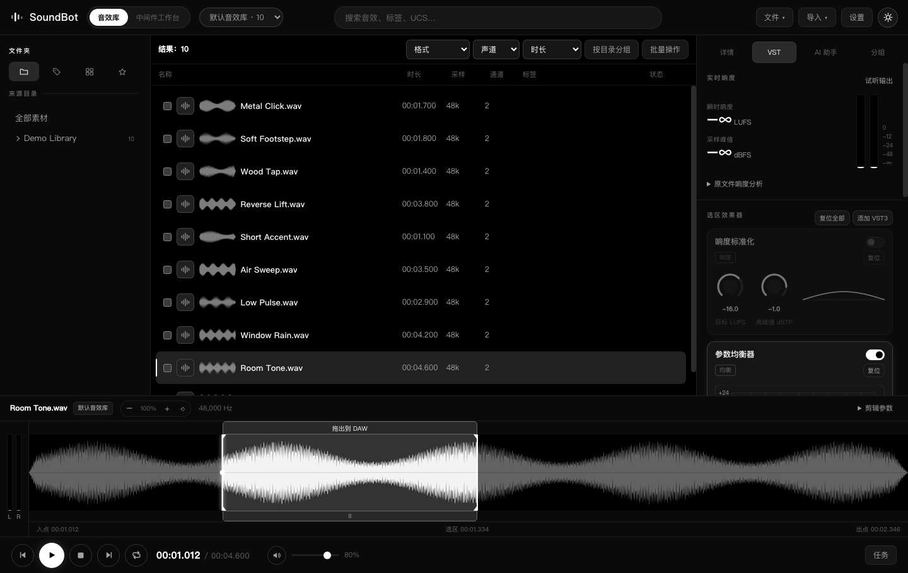
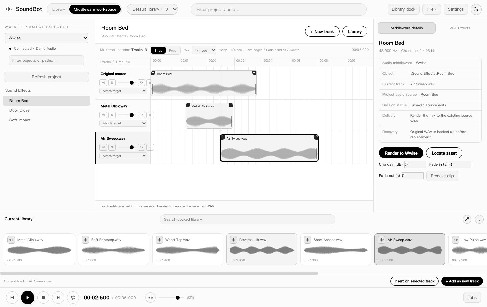

<h1 align="center">SoundBot</h1>

面向游戏音频的开源音效库管理器。在本地查找和剪辑音效，并交付到中间件工程。 An open-source sound library manager for game audio. Search and edit your local sounds, then deliver them to middleware projects.

<a href="#简体中文">简体中文</a> · <a href="#english">English</a> · <a href="https://github.com/Huckrick/SoundBot/releases">发行版本 / Releases</a>

## 简体中文

SoundBot 把音效查找、剪辑和交付放在同一个桌面应用里。素材库引用磁盘上的原始文件，按文件名、描述、标签和 UCS 分类做本地关键词检索。素材可边导入边检索，缩略波形按需生成。素材详情展示音频规格、原文件标签和嵌入封面。试听和剪辑支持选区、淡变、增益、参数均衡、混响及响度表。

### 界面语言

支持 **简体中文、繁體中文、日本語、English、Português (Brasil)、Español** 共六种语言。在 **设置 → 常规 → 语言** 切换，选择会在下次启动时保留。语言设置适用于 SoundBot 的音效库、波形编辑器、中间件工作台、菜单和设置。素材文件名、源标签及第三方宿主或插件自带的文字保留原文。

### 下载和安装

当前源码版本为 **v1.0.6（稳定版）**。安装包的发布状态以 GitHub Releases 为准。旧版保留在发行记录中，供查阅和回退。 [发行页](https://github.com/Huckrick/SoundBot/releases) · [更新日志](CHANGELOG.md)

| 平台 | 发行文件 | 安装方式 |
| --- | --- | --- |
| macOS 14 或更新版，Apple Silicon | `SoundBot-<版本>-arm64.dmg` | 打开镜像，将 SoundBot 拖到有写入权限的应用目录。 |
| Windows 10/11，x64 | `SoundBot-Setup-<版本>.exe` | 运行安装器并选择当前用户可写的安装目录。v1.0.1 起安装器配置为当前用户安装。 |

从同一发行条目下载安装包和 `SHA256SUMS.txt`。在 macOS 使用 `shasum -a 256 <文件>`，在 PowerShell 使用 `Get-FileHash -Algorithm SHA256 <文件>`，将输出与该文件的记录比对。如果系统阻止打开，先查看该发行条目的签名状态。

### 使用

在工作区按空格播放或暂停。文本输入区中的空格照常输入。

1. 新建音效库，拖入文件或目录。右键来源目录可检查变更。移动原文件后，用库内重定位关联新位置。
2. 选择素材，试听并在底部波形框选。第一次拖到 DAW 时，选择工程媒体目录。成品就绪后从选区上沿拖出，交付的 WAV 留在该目录。
3. 在中间件工作台编辑多轨。Wwise 通过本机 WAAPI 连接，可写回符合条件的 PCM WAV 并留存备份。FMOD Studio 和 CRI Atom Craft 接收渲染到工程素材目录的新 WAV，随后在宿主中导入或注册。 [宿主操作指南](docs/middleware.md)

在底部波形上滚动鼠标滚轮，以光标位置为中心缩放。按住 Shift 滚动可横移。从列表的缩略波形拖动整条素材到「中间件工作台」标签或时间线。拖到 DAW 时按住 Alt（Mac 上是 Option）。初次交付时选择工程媒体目录，文件准备好后再拖一次。

Wwise 工程浏览器可浏览和搜索整个已读取的工程树。拖动标尺可定位播放头，拖动剪辑两侧下半部可裁剪。在剪辑上拖动淡化手柄，右键选择曲线。在立体声目标上开启「声像曲线」，直接在波形上添加、拖动或右键移除控制点。同轨相邻剪辑部分重叠时自动交叉淡化，可在交叉区单独选择曲线。

打开 VST 面板时，SoundBot 自动查找标准安装目录中的 VST3。添加插件后会打开原生编辑窗口，点击插件名可再次打开。Windows 的编辑窗口跟随 SoundBot 主窗口，插件保留原生界面。窗口尺寸和缩放取决于插件编辑器的支持。可在右侧效果链拖动排序、旁通或移除插件。安装新插件后，可在 **设置 → VST3** 重新扫描。

音效库的试听共用一条主输出效果链，切换素材时保留当前设置。准备选区拖出时，SoundBot 将这条效果链渲染到 DAW 媒体目录中的 WAV。中间件工作台为每条轨道保留独立的效果和设置，交付成功后复位。插件处理失败时，试听会提示并继续播放旁通信号，交付会停止并保留编辑。

### 文件权限和隐私

| 操作 | 权限或数据 |
| --- | --- |
| 导入或试听 | 读取你选的文件及目录，索引和缓存放在本机应用数据目录。关键词检索、试听和剪辑可离线使用。 |
| 交付音频 | 写入选定的 DAW 媒体目录或中间件素材目录。Wwise 写回前会核对目标源文件并备份。 |
| 扫描和加载 VST3 | 扫描只读取标准安装目录和已登记的插件位置。选定插件并确认加载后，插件以当前用户身份运行本机代码。请选择可信来源。 |
| 使用可选助手 | 保存或使用服务 API 密钥时，系统可能要求访问钥匙串或凭据存储。SoundBot 的输入框只接收服务 API 密钥。调用远端服务时，助手将你的消息和对话上下文发往所配置的服务。 |

在 macOS 访问受保护的文件夹时，系统可能按目录弹出授权提示。若不能读取素材，可以在文件选择器改选可访问的目录。SoundBot 的日常使用无需全磁盘访问或管理员密码。升级前可备份应用数据目录。 [数据位置与验收说明](docs/release-review.md)

### 支持和反馈

- **无法启动或导入**：核对系统和架构，确认来源目录仍可访问。打开 **设置 → 关于 → 打开日志** 查看错误。本机日志可能含文件路径，分享前先脱敏。
- **版本和兼容性**：发行说明记录已通过的验证，包含已知限制。源码维护范围和漏洞处理方式见安全政策。 [发行页](https://github.com/Huckrick/SoundBot/releases) · [安全政策](.github/SECURITY.md)
- 欢迎 Issue 和讨论区交流，不定时处理。出于发布安全考虑，本仓库不接收 Pull Request 与代码提交。请勿在公开区附密钥、素材、数据库、日志原文或私人路径。 [新建 Issue](https://github.com/Huckrick/SoundBot/issues/new/choose) · [讨论区](https://github.com/Huckrick/SoundBot/discussions) · [仓库政策](.github/CONTRIBUTING.md)

### 作者与致谢

SoundBot 由 **Huckrick** 发起、开发和维护，源码采用 GPL-3.0-or-later 许可。在 **设置 → 关于** 可查看作者、MiSans 使用与许可、组件来源和社区致谢。 [完整致谢与来源](docs/credits.md) · [许可证](LICENSE)

## English

SoundBot brings sound library search, waveform editing, and delivery into one desktop app. Libraries reference the original files and index names, descriptions, tags, and UCS categories. Search works during imports, and waveforms are generated on demand. Details show audio properties, source tags, and embedded artwork. The editor includes range selection, fades, gain, parametric EQ, reverb, and live loudness metering.

### Interface languages

SoundBot supports **Simplified Chinese, Traditional Chinese, Japanese, English, Brazilian Portuguese, and Spanish**. Choose a language in **Settings → General → Language**. SoundBot remembers the choice and applies it to the library, waveform editor, middleware workspace, menus, and settings. File names, source tags, and labels supplied by external hosts or plug-ins stay in their original language.

### Download and install

The current source version is **v1.0.6 (stable)**. GitHub Releases shows which installers have been published. Older releases remain in the archive for reference and rollback. [Releases](https://github.com/Huckrick/SoundBot/releases) · [Changelog](CHANGELOG.md)

| Platform | Release file | Installation |
| --- | --- | --- |
| macOS 14 or later, Apple Silicon | `SoundBot-<version>-arm64.dmg` | Open the disk image and drag SoundBot to an applications folder you can write to. |
| Windows 10/11, x64 | `SoundBot-Setup-<version>.exe` | Run the installer and choose a folder you can write to. From v1.0.1 the installer is configured for the current user. |

Download the installer and `SHA256SUMS.txt` from the same release. Run `shasum -a 256 <file>` on macOS or `Get-FileHash -Algorithm SHA256 <file>` in PowerShell and compare the result with the entry for that file. If your OS blocks the app, check the signing status in the release notes first.

### Use SoundBot

Press Space to play or pause in the workspace. In text fields, Space types a space.

1. Create a library and drop in files or folders. Right-click a source folder to check for changes. If files move, use the library's relocation action to update their paths.
2. Select a sound and mark a range in the bottom waveform. For the first DAW delivery, choose the project's media folder. Once the file is ready, drag from the top of the selection. The rendered WAV stays in the selected folder.
3. Edit tracks in the middleware workspace. Wwise connects over local WAAPI and can write back eligible PCM WAV sources with a recovery backup. FMOD Studio and CRI Atom Craft receive a new WAV in their asset folder. Import or register it in the host. [Middleware guide](docs/middleware.md)

Scroll over the waveform editor to zoom around the pointer. Hold Shift while scrolling to pan. Drag a thumbnail waveform to send the whole sound to the middleware tab or timeline. Hold Alt (Option on Mac) to drag it to a DAW. On the first delivery, choose the project's media folder and drag again once the WAV is ready.

Browse or search the full hierarchy loaded from Wwise. Drag the ruler to seek and the lower clip edges to trim. Drag a fade handle on the clip and right-click it to choose a curve. For stereo targets, turn on Pan curve to add, drag, or remove points on the waveform. Partial overlaps between adjacent clips on the same track crossfade automatically. Choose a curve for an individual overlap from its menu.

SoundBot searches the standard VST3 folders when you open the VST panel. Adding a plug-in opens its native editor. Click its name to reopen it. On Windows, the native editor opens in a tool window owned by SoundBot. Window resizing and zoom depend on the plug-in editor. Drag to reorder plug-ins in the effects rack, or use the bypass and remove buttons. Rescan in **Settings → VST3** after installing a plug-in.

The library uses one master audition chain and keeps its settings as you switch sounds. Preparing a selection for drag-out renders that chain into the WAV in the DAW media folder. Each middleware track keeps its own effects and settings until successful delivery, when the chains reset. If a plug-in fails during audition, SoundBot reports it and continues with the affected plug-in bypassed. Delivery stops on a processing error and keeps your edits.

### Permissions and privacy

| Action | Access or data |
| --- | --- |
| Import or audition | Reads the files and folders you select and stores the index and cache locally. Keyword search, audition, and editing work offline. |
| Deliver audio | Writes to the selected DAW or middleware asset directory. Wwise writeback checks the target source and keeps a backup. |
| Discover and load VST3 | Discovery reads the standard installation folders and previously registered plug-in locations. A selected plug-in runs native code under your account after you confirm. Use plug-ins from sources you trust. |
| Use the optional assistant | Your OS may ask for access to its credential store when you save or use a service API key. Enter only the service API key into SoundBot. When you use a remote assistant, SoundBot sends the message and conversation context to the configured service. |

macOS may ask for access to a protected folder you select. If access is denied, select a folder that you can read. Routine SoundBot use requires neither full disk access nor an administrator password. Back up the app data directory before upgrading. [Data locations and release review](docs/release-review.md)

### Support and feedback

- **Startup or import problems.** Check the OS and architecture and make sure the source folder is accessible. Open **Settings → About → Open logs** for local diagnostics. Remove personal paths and other sensitive details before sharing excerpts.
- **Versions and compatibility.** Release notes record the validation performed and any known limitations. See the security policy for supported versions and vulnerability handling. [Releases](https://github.com/Huckrick/SoundBot/releases) · [Security policy](.github/SECURITY.md)
- Issues and discussions are welcome, handled as time allows. Pull requests and code submissions are not accepted, to keep the release pipeline safe. Do not attach keys, audio, databases, raw logs, or private paths in public. [Open an issue](https://github.com/Huckrick/SoundBot/issues/new/choose) · [Discussions](https://github.com/Huckrick/SoundBot/discussions) · [Repository policy](.github/CONTRIBUTING.md)

Builds use Python 3.12 and Node.js 24. The native GitHub Actions workflow builds and tests both installers and prepares a draft with checksums and provenance. [构建与发布 / Build and release](docs/build-and-retrieval.md) · [合规核对 / Distribution review](docs/release-review.md)

### Authorship and credits

**Huckrick** created, develops, and maintains SoundBot under GPL-3.0-or-later. Open **Settings → About** for authorship, MiSans use and licensing, component references, and community thanks. [Full credits and sources](docs/credits.md) · [License](LICENSE) · [Third-party notices](tests/build/licenses/THIRD_PARTY_AUDIO_NOTICES.txt)
